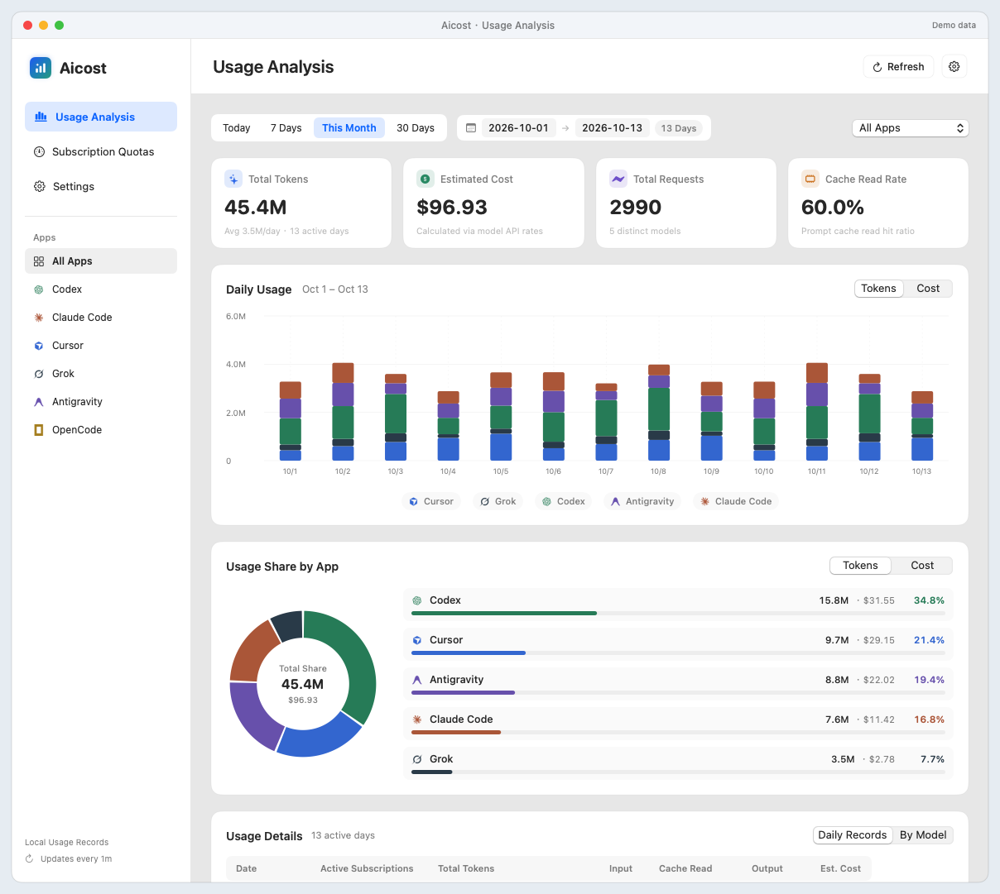
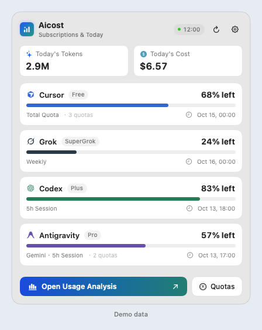
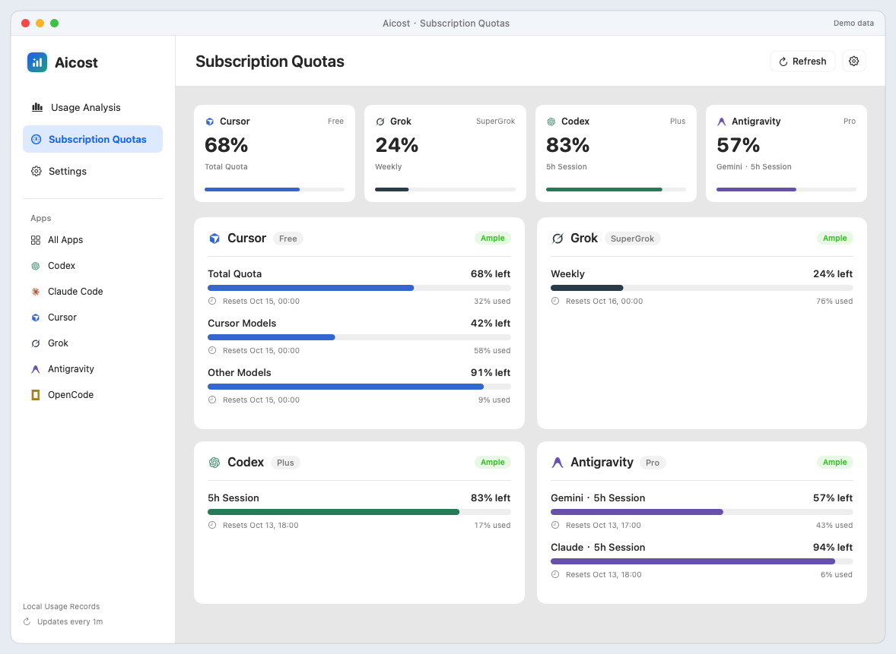

# Aicost

[简体中文](README.zh-CN.md) · English

A native macOS menu bar app for AI subscription quotas and local token usage.

[Download the latest release](https://github.com/saga029/Aicost/releases/latest) · [Interface previews](#interface-previews) · [Build from source](#build-and-test)



All interface previews use synthetic demo data. They contain no real account or usage history.

## Requirements

- Apple Silicon Mac, macOS 15 or newer.
- Existing local accounts/session logs for the providers you use.
- Xcode Command Line Tools and Python 3 when building from source.

## Download

Download **Aicost-1.0.2-macos-arm64.zip** from [Releases](https://github.com/saga029/Aicost/releases), extract it, and move `Aicost.app` to Applications. This release uses an ad-hoc signature and is not Apple-notarized; macOS may require approval through Finder / Privacy & Security on first launch.

## Features

- Menu bar quota icons, names and remaining percentages. While weekly and monthly allowances remain, the menu bar shows the 5-hour balance, or the monthly balance when there is no 5-hour window. A used-up weekly or monthly allowance shows 0% and hides the 5-hour balance.
- Quota cards keep the 5-hour, weekly and monthly windows together.
- Daily stacked usage, per-app shares and model breakdowns.
- Today, this month, past 7/30 days and custom ranges up to 31 days.
- English and Simplified Chinese, with responsive quota cards.
- Daily grouping and reset times follow the device's current time zone, including daylight saving time. App error messages follow the selected interface language.
- Local history, manual refresh and launch-at-login settings.

## Interface previews

### Menu bar summary

Check remaining quotas, today's tokens and estimated cost without opening the dashboard.

<p align="center">
  
</p>

### Subscription quotas

Compare providers, inspect individual quota windows and see reset times in the device's current time zone.



## Build and test

```sh
python3 scripts/test.py
python3 scripts/build.py
open build/Aicost.app
python3 scripts/package.py
```

The build downloads the public Runway **v0.8.17** release, verifies its pinned SHA-256, and uses only its CLI helper, runtime framework and static resource bundle. The Aicost UI is compiled from this repository. The upstream source is linked in [THIRD_PARTY_NOTICES.md](THIRD_PARTY_NOTICES.md).

## Data and privacy

Aicost reads local usage metadata from Codex, Claude Code, Grok and Antigravity. The bundled Runway CLI can reuse local credentials to request quotas from the corresponding provider. An optional installed `agy` CLI or direct Google quota query supplements Antigravity Gemini quotas. These requests go to the provider, not to an Aicost backend. The optional OpenUsage service is read at `127.0.0.1:6736`.

Usage history is stored in `~/Library/Application Support/Aicost`. Aicost's history cache contains dates, models and numeric usage/cost data, not conversation content or credential values. Aicost does not include an analytics or telemetry backend. See [PRIVACY.md](PRIVACY.md) for the distinction between local processing and provider requests.

Version 1.0.1 keeps separate daily archives for each device time zone and rebuilds them from available timestamped records. The old `history-v1.json` remains on the device; daily totals from that fixed-zone archive are not carried into a different grouping. Records whose original timestamps are no longer available cannot be regrouped. OpenUsage's date-only chart labels retain their reported calendar dates.

## Current limits

- Token/cost estimates depend on available logs and pricing coverage. Displayed costs are API-equivalent estimates, not subscription invoices.
- Moving or deleting source logs can change historical daily totals.
- Only English and Simplified Chinese are supported.

## License

MIT. Includes MIT-licensed Runway/OpenUsage components and other notices in [licenses/](licenses/) and [THIRD_PARTY_NOTICES.md](THIRD_PARTY_NOTICES.md). Aicost is an independent application, not an official client of the listed AI providers.
