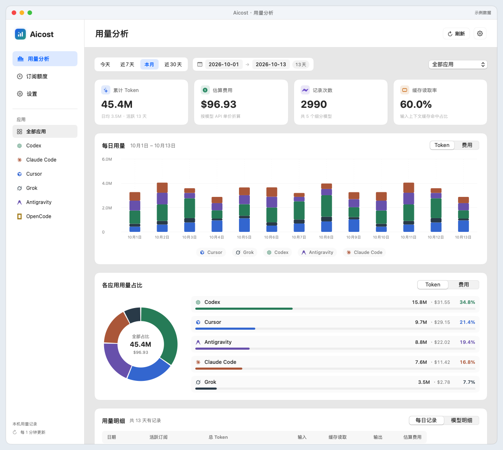
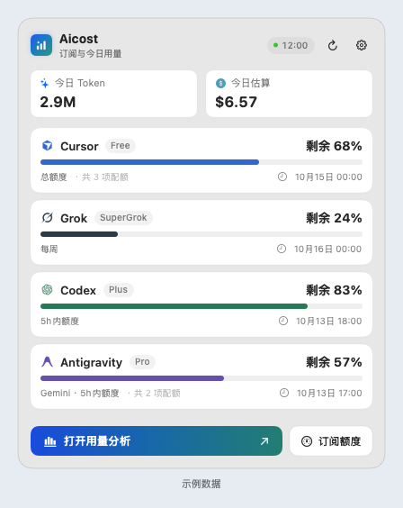
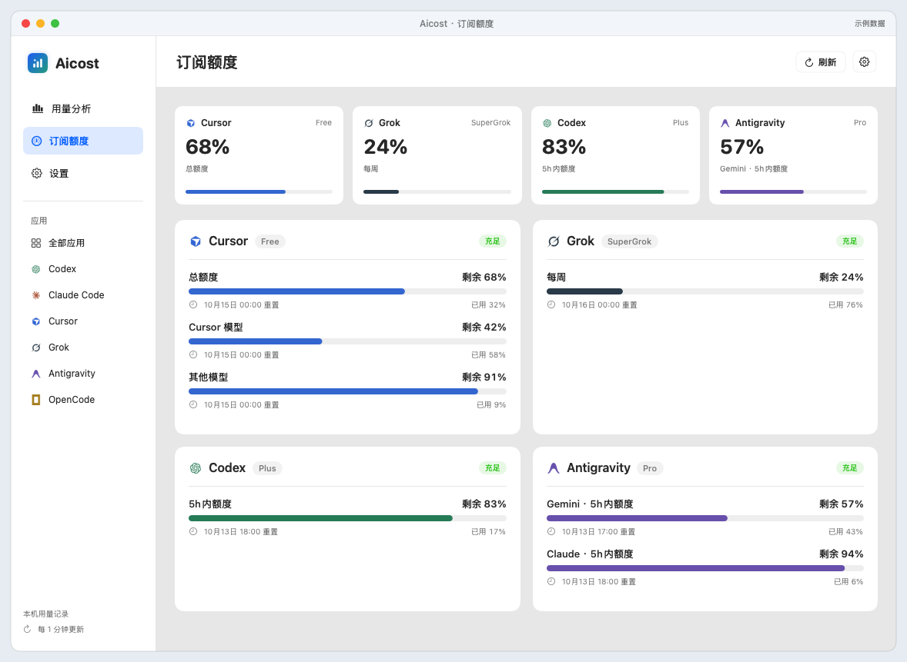

# Aicost

简体中文 · [English](README.md)

原生 macOS 菜单栏 AI 订阅额度与本机 Token 用量分析工具。

[下载最新版](https://github.com/saga029/Aicost/releases/latest) · [界面预览](#界面预览) · [源码构建](#构建)



所有界面图均使用虚构示例数据，不含真实账号或个人用量历史。

## 下载与安装

需要 **Apple Silicon / macOS 15+**。从 [Releases](https://github.com/saga029/Aicost/releases) 下载 `Aicost-1.0.3-macos-arm64.zip`，解压后将 `Aicost.app` 放入应用程序目录。本次版本采用临时签名，尚未通过 Apple 公证，首次启动可能需要通过 Finder 或系统“隐私与安全性”批准打开。

## 功能

- 菜单栏订阅图标、名称与剩余额度。周额度、月额度未用完时显示 5 小时剩余；没有 5 小时窗口时显示月额度。周额度或月额度用完后显示 0%，不再显示 5 小时额度。点击菜单栏后，Antigravity 显示 Gemini 的 5 小时额度和每周额度。
- 额度页同时保留 5 小时、每周和每月窗口。Antigravity 额度卡只显示 Gemini。
- 每日堆叠用量、各应用占比、模型明细及 API 等价费用估算；每日记录适配默认窗口，无需横向滚动。
- 本机统计独立于远端额度更新，缓存 Claude 日志扫描并合并重复刷新；Antigravity 套餐支持从客户端或可选 `agy` CLI 读取。
- 今天、本月、近 7/30 天与最长 31 天的自定义区间。
- 中英文界面、自适应额度卡片、本机历史、手动刷新与登录后启动。
- 日统计和重置时间跟随设备当前时区，支持夏令时；应用错误提示跟随界面语言。

## 界面预览

### 菜单栏速览

查看各服务的剩余额度、今日 Token 与估算费用，直接进入用量分析或订阅额度。

<p align="center">
  
</p>

### 订阅额度

汇总各服务额度，展开查看不同周期的剩余比例，以及设备当前时区下的重置时间。



## 构建

需要 Xcode Command Line Tools 与 Python 3：

```sh
python3 scripts/test.py
python3 scripts/build.py
open build/Aicost.app
python3 scripts/package.py
```

构建脚本下载并校验固定版本 Runway v0.8.17，仅使用其公开 CLI、运行时框架和静态资源；Aicost 界面从本仓库源码编译。依赖来源与许可证见 [THIRD_PARTY_NOTICES.md](THIRD_PARTY_NOTICES.md)。

## 隐私与数据来源

读取本机 Codex、Claude Code、Grok 和 Antigravity 用量元数据；配额采集器可使用本机已有凭据向相应服务商请求额度。可选使用本机已安装的 `agy` CLI 或直接查询 Google 补充 Antigravity Gemini 额度。没有 Aicost 云端或遥测后台。可选读取 `127.0.0.1:6736` 的 OpenUsage 接口。

Aicost 的历史缓存位于 `~/Library/Application Support/Aicost`，保存日期、模型与用量/费用数值，不保存会话正文或凭据值。发布源码和安装包不包含使用者的账户、用量历史或本机配置。详情见 [PRIVACY.md](PRIVACY.md)。

1.0.1 为各设备时区分别保存日统计，并从仍可读取的带时间戳记录重新分组。旧 `history-v1.json` 保留在本机，其按固定时区汇总的日总量不会直接带入新分组；原始时间戳已不存在的记录无法重新分组。OpenUsage 仅提供日期的图表数据保留其原始日期。

## 当前限制

费用是可定价记录的 API 等价估算，不是订阅账单。日志移动或删除可能影响历史统计。目前仅支持简体中文与 English。

## 开源

MIT 协议。保留 Runway/OpenUsage 等上游项目的许可证与致谢。本项目独立维护，与所列服务商无官方关联。
